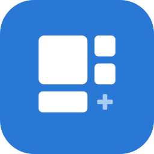
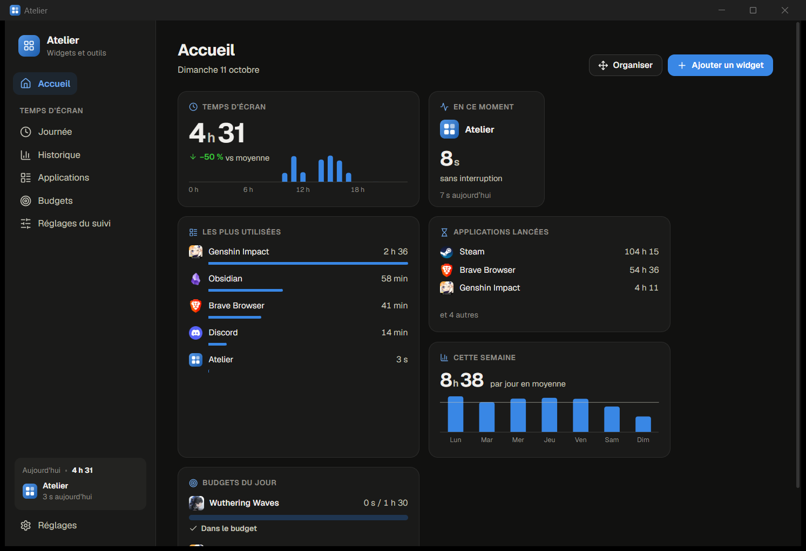
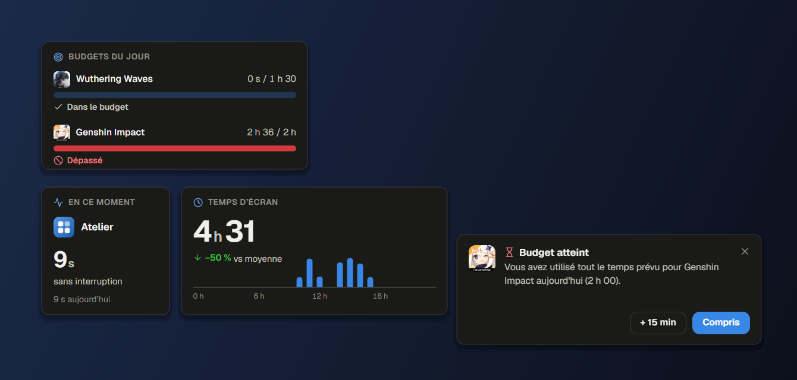
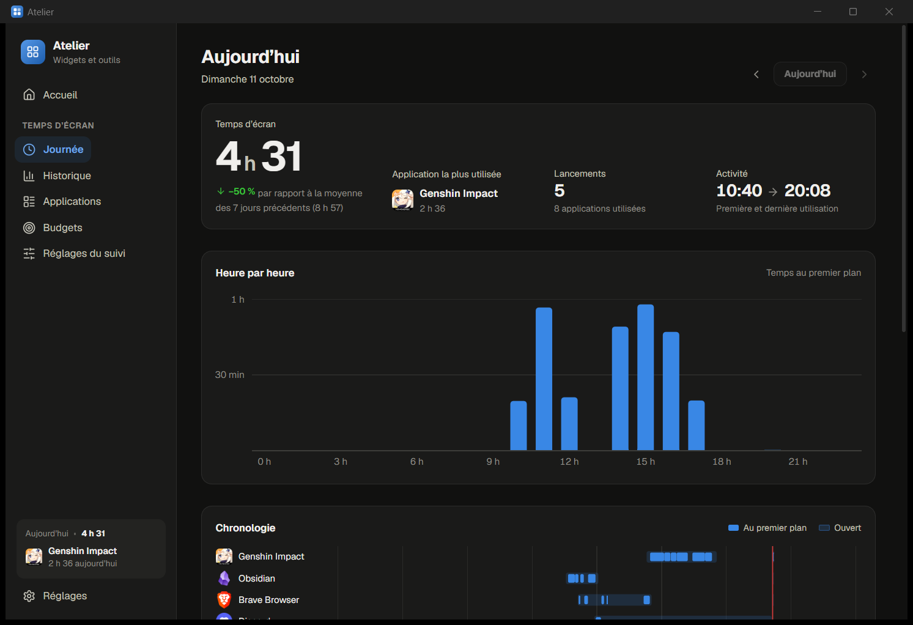
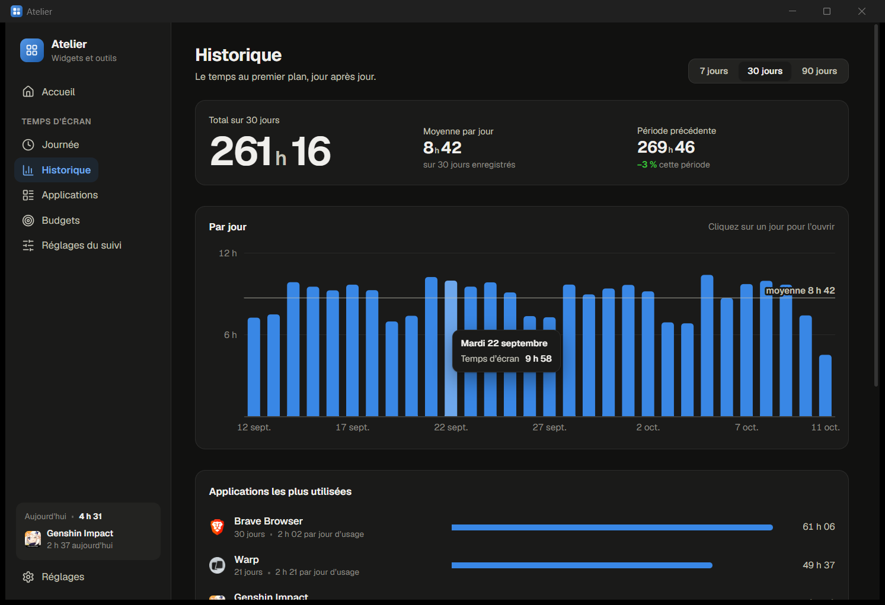
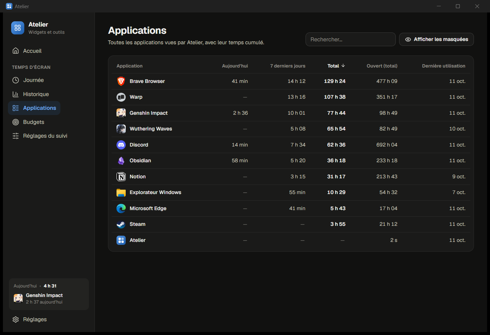
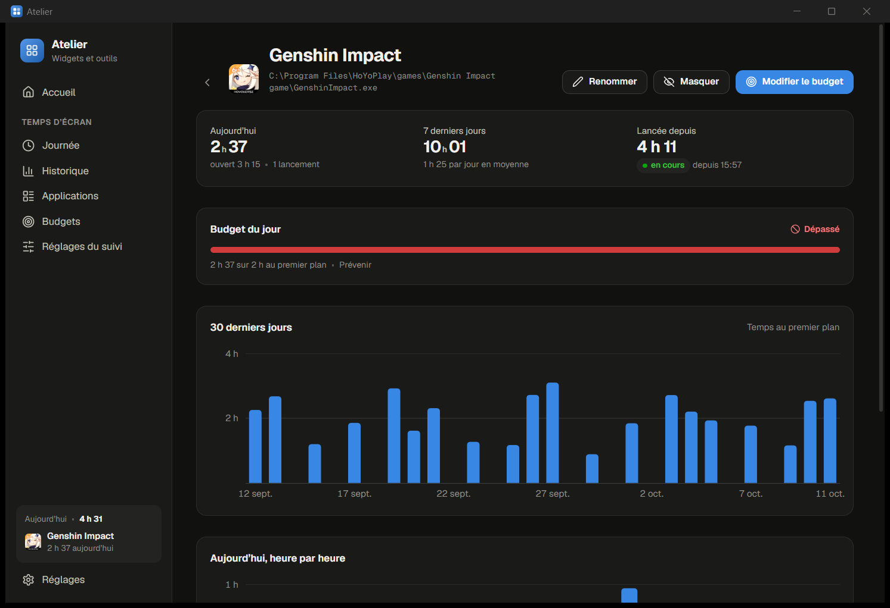
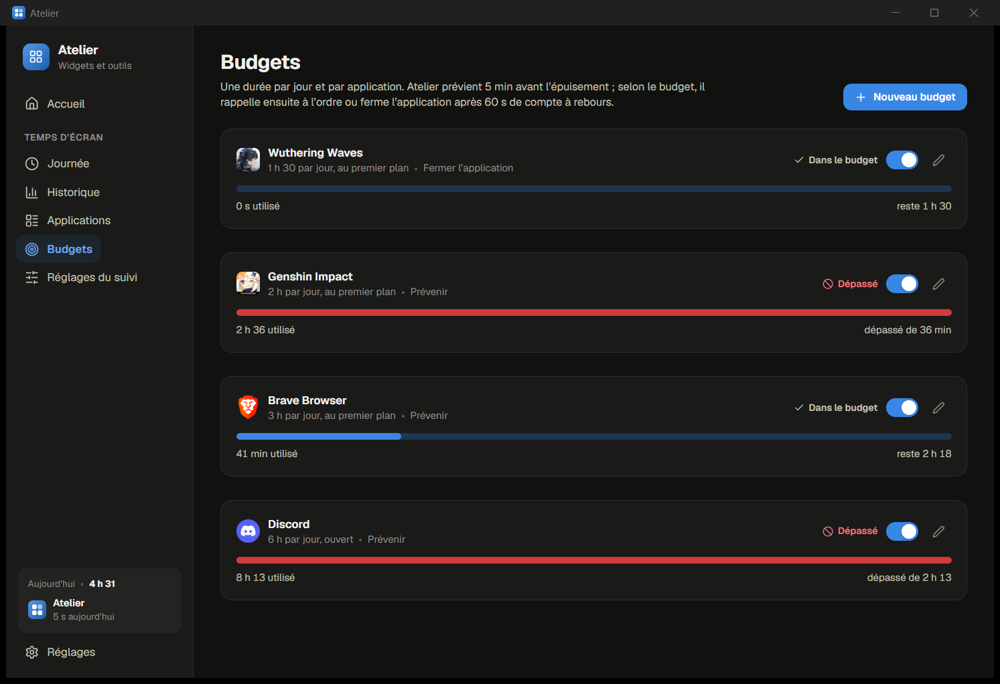

<p align="center">
  
</p>

<h1 align="center">Atelier</h1>

<p align="center">
  Une petite application de bureau pour Windows, organisée autour des widgets.<br />
  Trois modules : le temps d'écran, avec des budgets qui préviennent ou ferment l'application,
  ce qui encombre le système, avec de quoi y remédier, et un raccourci qui fait lire le
  presse-papiers à voix haute.
</p>

<p align="center">
  <a href="https://github.com/pedrokarim/atelier/actions/workflows/ci.yml"></a>
  <a href="https://github.com/pedrokarim/atelier/releases/latest"></a>
  
  <a href="LICENSE"></a>
</p>

<p align="center">
  
</p>

Atelier vit dans la zone de notification et héberge des **modules**. Chaque
module apporte ses pages et ses **widgets** ; un widget se pose sur la grille
de l'accueil, ou s'épingle sur le bureau comme une petite fenêtre flottante.

- **Un seul exécutable** d'environ 1,4 Mo, sans DLL : l'interface est rendue
  par WebView2, le moteur d'Edge, déjà présent sur Windows 11.
- **Rien ne quitte l'ordinateur sans raison** : aucune mesure, aucun historique n'est envoyé. Seules sortent la vérification des mises à jour (une lecture de la page des versions sur GitHub, qui se coupe) et, à la demande, le texte confié à la synthèse vocale.
- **Extensible** : ajouter un widget, par exemple les cours de la bourse,
  revient à écrire un module, sans toucher au cœur.

## Sommaire

- [Installation](#installation)
- [Aperçu](#aperçu)
- [Utilisation](#utilisation)
- [Le module Temps d'écran](#le-module-temps-décran)
- [Le module Système](#le-module-système)
- [Le module Synthèse vocale](#le-module-synthèse-vocale)
- [Ajouter un module](#ajouter-un-module)
- [Développement](#développement)
- [Licence](#licence)

## Installation

Télécharger la dernière version depuis la page
[**Releases**](https://github.com/pedrokarim/atelier/releases/latest) :

| Fichier | Pour qui |
| --- | --- |
| `atelier-<version>-setup.exe` | L'installation classique : menu Démarrer, démarrage avec Windows, désinstallation depuis les Paramètres. Aucun droit d'administrateur demandé. |
| `atelier-<version>-portable.zip` | Sans installation : décompresser et lancer `atelier.exe`. Les données restent dans le dossier `data` à côté. |
| `SHA256SUMS.txt` | Empreintes pour vérifier les téléchargements. |

> Windows SmartScreen peut avertir au premier lancement : l'exécutable n'est
> pas signé, et l'avertissement indique « Éditeur inconnu ».
> *Informations complémentaires*, puis *Exécuter quand même*. Les propriétés
> du fichier et les Paramètres de Windows nomment l'éditeur : Ascencia.

L'option « Lancer Atelier à l'ouverture de session » est cochée par défaut
dans l'installateur : le temps d'écran n'est compté que pendant qu'Atelier
tourne.

**Depuis les sources** (chaîne Rust stable) :

```sh
git clone https://github.com/pedrokarim/atelier.git
cd atelier
cargo build --release
# target/release/atelier.exe
```

## Aperçu

> Captures réalisées avec des données de démonstration.

### Des widgets, sur l'accueil ou sur le bureau

Les widgets existent en quatre tailles. Ils se réorganisent par
glisser-déposer, et chacun peut s'épingler sur le bureau, où il se déplace en
le saisissant par son titre. Les notifications apparaissent dans le coin de
l'écran, sans prendre le focus.

<p align="center">
  
</p>

### La journée

Le total du jour comparé à la moyenne, la répartition heure par heure, la
chronologie de chaque application (au premier plan, ou simplement ouverte) et
le classement.

<p align="center">
  
</p>

### L'historique

Sur 7, 30 ou 90 jours, avec la moyenne et la comparaison à la période
précédente. Un clic sur un jour l'ouvre en détail.

<p align="center">
  
</p>

### Chaque application

<table>
  <tr>
    <td></td>
    <td></td>
  </tr>
  <tr>
    <td align="center">Toutes les applications, triables</td>
    <td align="center">La fiche : 30 jours, sessions, budget, depuis quand elle tourne</td>
  </tr>
</table>

### Les budgets

<p align="center">
  
</p>

## Utilisation

Au premier lancement, la fenêtre s'ouvre sur l'accueil, garni des widgets par
défaut. Ensuite, Atelier reste dans la zone de notification :

- **clic gauche** sur l'icône : ouvrir Atelier ;
- **clic droit** : afficher ou masquer les widgets du bureau, démarrage avec
  Windows, quitter.

Relancer `atelier.exe` alors qu'il tourne déjà ouvre simplement sa fenêtre.

| Action | Où |
| --- | --- |
| Ajouter un widget | Accueil, bouton **Ajouter un widget** |
| Changer sa taille | Menu du widget (bouton à trois points) |
| Réorganiser la grille | Accueil, bouton **Organiser**, puis glisser-déposer |
| Épingler sur le bureau | Menu du widget, **Épingler sur le bureau** |
| Déplacer un widget du bureau | Le saisir par son titre |
| Le garder au-dessus des fenêtres | Clic droit sur le widget, **Toujours au premier plan** |
| Masquer tous les widgets du bureau | Clic droit sur l'icône de notification |

Une case de la grille mesure 172 pixels ; les tailles couvrent une case, deux
cases côte à côte, un carré de quatre cases, ou une bande de quatre cases. Un
widget a les mêmes dimensions sur l'accueil et sur le bureau.

### Mises à jour

Atelier consulte la page des versions sur GitHub une minute après son
lancement, puis toutes les 12 heures. Quand une version plus récente existe,
une notification propose de l'installer :

1. l'installateur de la nouvelle version est téléchargé, puis comparé à son
   empreinte publiée (`SHA256SUMS.txt`) : au moindre écart, rien n'est lancé ;
2. il s'exécute sans fenêtre, Atelier se ferme le temps de la copie ;
3. l'installateur relance Atelier, qui confirme la nouvelle version.

Les données ne sont pas touchées. Dans **Réglages**, la carte *Mises à jour*
montre la version en cours, vérifie à la demande et coupe la vérification
automatique. Une copie portable est seulement prévenue : il suffit de
remplacer `atelier.exe` par celui de la nouvelle archive.

### Ligne de commande

| Option | Effet |
| --- | --- |
| *(aucune)* | Mode résident, ou ouverture de la fenêtre si Atelier tourne déjà |
| `--show` | Ouvre la fenêtre principale dès le démarrage |
| `--open <page>` | Ouvre une page : `home`, `settings`, `screen-time/budgets`… |
| `--install` / `--uninstall` | Installation locale et raccourci du menu Démarrer |
| `--data-dir` | Affiche le dossier des données |

### Données

```
%APPDATA%\atelier\
  layout.json                    widgets de l'accueil et du bureau
  update.json                    vérification des mises à jour
  atelier.log                    journal
  webview\                       profil du moteur de rendu
  modules\screen-time\
    config.json                  réglages et budgets
    apps.json                    applications connues (nom, chemin, icône)
    days\AAAA-MM-JJ.json         une journée d'utilisation
  modules\system\
    config.json                  notifications, applications ignorées
  modules\speech\
    config.json                  raccourci, ouverture dans Edge, réglages de lecture
```

**Mode portable** : si un dossier `data` existe à côté de l'exécutable, tout y
est rangé à la place. L'archive portable est livrée avec ce dossier.

## Le module Temps d'écran

Deux mesures, parce qu'elles répondent à deux questions différentes :

- **au premier plan** : l'application est devant vous, et vous êtes là
  (clavier ou souris actifs depuis moins de 5 minutes, ou application en plein
  écran, pour les jeux à la manette et les vidéos) ;
- **ouvert** : un processus de l'application est lancé, qu'on le regarde ou
  non. C'est la réponse à « depuis quand le jeu tourne-t-il ? ».

Widgets : *Temps d'écran*, *En ce moment*, *Applications lancées*, *Les plus
utilisées*, *Cette semaine*, *Budgets du jour*.

### Budgets

Une durée par jour et par application, remise à zéro à minuit. Pour chaque
budget, on choisit :

- **ce qui est compté** : le temps au premier plan, ou le temps où
  l'application est lancée (plus strict) ;
- **ce qui arrive à l'épuisement** :
  - *Prévenir* : notification à l'approche, à l'épuisement, puis rappels
    réguliers ;
  - *Fermer l'application* : notification avec compte à rebours (60 s par
    défaut), demande de fermeture polie à ses fenêtres, puis arrêt forcé 10 s
    plus tard si elle résiste. Relancée, elle est refermée de la même façon.

Chaque notification propose une **rallonge** (15 min par défaut), comptée
dans la journée. Toutes ces durées se règlent dans **Réglages du suivi**.

### Limites connues

- Le temps n'est compté que pendant qu'Atelier tourne.
- Un jeu en plein écran **exclusif** passe devant les notifications ; le mode
  « fenêtré sans bordure » les laisse visibles. La fermeture fonctionne dans
  les deux cas.
- Une application lancée en administrateur peut refuser d'être fermée par un
  programme qui ne l'est pas.
- Une partie à la manette dans une fenêtre qui n'occupe pas tout l'écran passe
  pour une absence au bout de 5 minutes sans clavier ni souris (réglable).

## Le module Système

Ce qui encombre l'ordinateur, et de quoi y remédier. Atelier fait un relevé
de la mémoire et de chaque processus, sans droits d'administrateur, et
signale ce qui a l'air anormal :

| Signalé | Quand |
| --- | --- |
| **Handles accumulés** | un processus garde plus de 50 000 handles ouverts (critique au-delà de 500 000) ; un programme ordinaire en a quelques milliers. Chacun occupe de la mémoire du noyau, qu'aucun gestionnaire de tâches n'impute au processus |
| **Mémoire accaparée** | une application, tous processus confondus, occupe plus de 12 % de la mémoire (et au moins 2 Go) |
| **Processeur sollicité** | un processus sans fenêtre utilise plus de 20 % de la machine pendant plus de 30 secondes |
| **Resté seul** | une commande en ligne de commande, sans fenêtre, dont le terminal ou le script s'est fermé il y a plus de 10 minutes |

Pour l'ordinateur entier, la page **Encombrement** répartit la mémoire
(applications, noyau, partagé, disponible) et alerte quand le noyau gonfle,
quand la mémoire disponible vient à manquer ou quand la mémoire engagée
approche de sa limite. La page **Processus** liste chaque application avec
la somme de ses processus, triable et dépliable.

Actions :

- **Demander la fermeture** : un message de fermeture aux fenêtres de
  l'application, qui peut proposer d'enregistrer ;
- **Arrêter** : l'arrêt immédiat du processus, ou de tous ceux d'une
  application, après confirmation. Le processus visé est identifié par son
  numéro **et** son heure de lancement : un successeur qui aurait hérité du
  numéro n'est jamais arrêté à sa place ;
- **Ne plus signaler** : une application gourmande par nature, un jeu par
  exemple, n'apparaît plus dans *À traiter* ;
- **Ouvrir l'emplacement** de l'exécutable.

Les processus de Windows (services, `svchost.exe`, `csrss.exe`…) et ceux
d'Atelier lui-même sont **protégés** : aucune action ne les vise. Une
surveillance de fond refait le relevé toutes les 10 secondes et, sauf si on
la coupe, prévient par une notification quand un processus accumule les
handles ou accapare la mémoire sans aucune fenêtre ouverte.

Widgets : *Mémoire*, *Ce qui encombre* (arrêt sur place, en deux clics),
*Les plus gourmandes*. Si le module Temps d'écran est présent, ses noms et
icônes d'applications sont repris.

## Le module Synthèse vocale

Un raccourci global envoie le contenu du presse-papiers vers la synthèse
vocale de [Just Tools](https://just-tools.ascencia.re), qui démarre la
lecture toute seule :

```
Ctrl+Alt+S  →  presse-papiers  →  base64url  →  Edge  →  /tools/text-to-speech?b64=…&autoplay=1
```

Le module remplace le programme autonome `tts-hotkey`. Au premier lancement,
il reprend ses réglages (`%APPDATA%\just-tools\tts-hotkey.toml`). Tant que
l'ancien programme tourne, Windows lui réserve le raccourci : la page
**Lecture** le signale et propose de le retirer (arrêt, installation,
raccourci du menu Démarrer, démarrage automatique). Ses réglages et son
journal restent en place.

La page **Lecture** montre l'état du raccourci, lit le presse-papiers ou un
texte saisi, et rappelle la dernière lecture. La page **Réglages** reprend
tout ce que réglait l'ancien programme :

| Réglage | Effet |
| --- | --- |
| Raccourci global | Capturé au clavier ; au moins un modificateur (Ctrl, Alt, Shift, Win). Il est suspendu le temps de la saisie |
| Mode d'ouverture | *Fenêtre applicative* (`--app=`, sans rien installer), *PWA installée* (réutilise sa fenêtre, demande son identifiant), *Onglet* |
| Lecture | Lecture automatique, interface « lecteur », débit, hauteur, volume, voix, langue |
| Traitement du texte | Longueur maximale, espaces aplatis, mots coupés en fin de ligne recollés |
| Déblocage de la lecture | Fenêtre mise au premier plan, frappe F24, délai, bip |

**Tester** lit le presse-papiers avec les réglages en cours d'édition, sans
les enregistrer ; **Afficher l'adresse** montre ce qui serait ouvert, sans
rien lancer.

Pourquoi une frappe F24 : Chromium refuse `speechSynthesis.speak()` sur un
document qui n'a reçu aucune interaction. Après l'ouverture, Atelier met la
fenêtre de l'outil au premier plan et envoie une frappe F24 ; c'est une vraie
frappe au niveau du système, que le navigateur compte comme un geste de
l'utilisateur. Aucun clavier courant n'a de touche F24 : aucun effet de bord
dans la page.

Widget : *Synthèse vocale*, le raccourci et un bouton de lecture.

### Limites connues

- La ligne de commande de Windows est limitée à 32 767 caractères : le texte
  est tronqué au-delà de la longueur maximale (12 000 par défaut).
- En mode *Fenêtre applicative*, chaque lecture ouvre une fenêtre ; le mode
  *PWA installée* réutilise la sienne.
- Certaines combinaisons `Win+…` sont réservées par Windows et n'atteignent
  aucun programme. Un raccourci refusé laisse l'ancien actif, et une
  notification l'explique.

## Ajouter un module

L'hôte fournit tout le reste : grille d'accueil, catalogue des widgets,
tailles, épinglage sur le bureau, notifications, thème clair ou sombre,
persistance de la disposition. Un module n'écrit que ce qui lui est propre.
Exemple : un widget de bourse.

**1. La moitié Rust** : `src/modules/markets.rs`

```rust
use serde_json::{Value, json};
use super::Module;
use crate::ipc::Responder;

pub struct Markets;

impl Module for Markets {
    fn id(&self) -> &'static str { "markets" }

    fn script(&self) -> &'static str {
        include_str!("../../ui/modules/markets.js")
    }

    fn handle(&self, method: &str, params: Value, reply: Responder) {
        match method {
            // Le répondeur peut partir dans un autre fil : l'interface ne
            // se fige pas pendant la requête réseau.
            "quote" => {
                let symbol = params["symbol"].as_str().unwrap_or("AAPL").to_string();
                std::thread::spawn(move || {
                    let price = 0.0; // appel au service de cotation
                    reply.ok(json!({ "symbol": symbol, "price": price }));
                });
            }
            other => reply.err(format!("méthode inconnue : {other}")),
        }
    }
}
```

**2. La moitié page** : `ui/modules/markets.js`

```js
Atelier.module({ id: "markets", name: "Bourse", icon: "chart", pages: [] });

Atelier.widget({
  id: "markets.quote",
  module: "markets",
  title: "Bourse",
  description: "Le cours d'une action, mis à jour toutes les 30 secondes.",
  icon: "chart",
  sizes: ["s", "m"],
  refresh: 30,
  async render(el, ctx) {
    const quote = await ctx.request("quote", { symbol: "AAPL" });
    el.innerHTML = `<div class="w-hero">${quote.price}</div>
                    <div class="w-sub">${ctx.escape(quote.symbol)}</div>`;
  },
});
```

**3. L'inscription** : `pub mod markets;` et une ligne dans `registry()`, dans
`src/modules/mod.rs`.

Le widget apparaît alors dans **Ajouter un widget**, change de taille et
s'épingle sur le bureau. Un module peut aussi :

| Besoin | Moyen |
| --- | --- |
| Des pages dans la barre latérale | `pages: [{ id, title, icon, render(root, ctx) }]` |
| Un travail de fond permanent | `Module::start`, sur son propre fil |
| Prévenir l'utilisateur | `ModuleContext.host.notify(Notice { … })`, boutons inclus |
| Pousser une mise à jour aux pages | `host.broadcast("markets.update", …)`, et `events` côté widget |
| Poser des widgets au premier lancement | `Module::default_widgets` |
| Ranger ses données | `paths::module_dir("markets")` |

Contrat complet : en tête de `ui/core.js` côté page, `src/modules/mod.rs` côté
Rust. Les icônes disponibles sont celles de la bibliothèque Lucide déclarées
dans `ui/core.js`.

## Développement

```sh
cargo test
cargo run -- --open home
```

En profil `debug`, le binaire garde une console et les outils de
développement de la vue web (F12). En `release`, il est fenêtré et journalise
dans `atelier.log`. Pour essayer sans toucher à ses vraies données, créer
`target\debug\data\` : le binaire de développement passe en mode portable.

| Fichier | Rôle |
| --- | --- |
| `src/main.rs` | Options de ligne de commande, instance unique |
| `src/app.rs` | Boucle de messages, zone de notification, fenêtres, aiguillage des requêtes |
| `src/webview.rs` | Fenêtres Win32 hébergeant une vue web, avec ou sans cadre |
| `src/update.rs`, `src/http.rs` | Mises à jour : dernière version sur GitHub, téléchargement vérifié, installation |
| `src/ipc.rs` | Requêtes des pages, répondeurs, événements des modules, notifications |
| `src/layout.rs` | Disposition des widgets (accueil et bureau) |
| `src/ui.rs` | Assemblage des pages embarquées, police |
| `src/modules/mod.rs` | Contrat d'un module, registre |
| `src/modules/screen_time/` | Module Temps d'écran : suivi, budgets, rapports |
| `src/modules/system/` | Module Système : relevés, analyse de l'encombrement, actions |
| `src/modules/speech/` | Module Synthèse vocale : raccourci global, presse-papiers, ouverture dans Edge, reprise de tts-hotkey |
| `ui/core.css`, `ui/core.js` | Styles, composants et noyau communs |
| `ui/shell.html` | Fenêtre principale |
| `ui/widget.html`, `ui/notice.html` | Widget du bureau, notification |
| `ui/modules/*.js` | Moitié page de chaque module |
| `installer/atelier.iss` | Installateur Inno Setup |
| `scripts/logo/` | Construit le logo et les icônes ; guide d'usage dans `assets/logo/README.md` |
| `scripts/audit/` | Audit de mise en page (voir ci-dessous) |

### Audit de mise en page

Aucun élément ne doit sortir de son cadre, en recouvrir un autre ou être
coupé. L'audit le vérifie sur le vrai programme : il le lance en mode
portable, s'y branche avec [Playwright](https://playwright.dev/python/) par
le port de débogage de WebView2, et mesure chaque écran dans la page
(`Atelier.audit()`).

| Ce qui est passé en revue | Valeurs |
| --- | --- |
| Écrans | chaque page, les boîtes de dialogue, le laboratoire des widgets (route `lab` : chaque widget dans chacune de ses tailles), les widgets du bureau, la notification |
| Thèmes | sombre et clair |
| Largeurs de fenêtre | 1920, 1440, 1280, 1024 et 860 pixels (le minimum de la fenêtre) |
| Données | vides, normales, extrêmes (noms très longs, 45 applications, budgets dépassés). Le module Système lit un relevé fictif (`modules/system/demo.json`) : aucune de ses actions ne vise un vrai processus pendant l'audit |

| Ce qui est signalé | |
| --- | --- |
| Sort de son conteneur | un élément dépasse du bloc qui le contient |
| Rogné par son cadre | un cadre qui masque ce qui dépasse en cache une partie |
| Chevauchement | deux blocs voisins se recouvrent |
| Texte coupé, tronqué sans infobulle | un texte est coupé net, ou tronqué sans que le texte complet soit lisible au survol |
| Défilement horizontal, hors de l'écran | la page défile en largeur, ou un menu sort de la fenêtre |

```sh
cargo build --release
python -m venv .venv
.venv\Scripts\python -m pip install -r scripts\audit\requirements.txt
.venv\Scripts\python scripts\audit\audit.py
# ou plus ciblé :
.venv\Scripts\python scripts\audit\audit.py --scenario extreme --theme clair --size 1024x768
```

Le rapport `audit-report/<date>/index.html` montre chaque écran, sa capture et
ses défauts. Le code de sortie vaut 1 s'il en reste un. Playwright se branche
sur le WebView2 du programme : aucun navigateur n'est téléchargé.

### Comparaison visuelle

Avant de publier une modification d'interface, on compare la nouvelle
version à la précédente : `compare.py` lance les deux exécutables sur des
données identiques, capture les mêmes écrans dans les mêmes conditions et
mesure la différence pixel à pixel. Le rapport montre chaque écran avant,
après, et les zones qui ont changé en rouge. Tout écart qui n'est pas une
correction voulue est une régression.

```sh
.venv\Scripts\python scripts\audit\compare.py --before <atelier.exe de la version précédente>
```

Un débordement voulu (fond de survol qui s'étend, bouton plaqué dans un coin)
se déclare en CSS par `--audit-bleed: 1` : l'audit ne le signale pas, et le
dessin n'a pas à changer pour lui plaire.

### Intégration continue et publication

- **CI** (`.github/workflows/ci.yml`) : à chaque push et pull request,
  formatage, Clippy, tests, puis construction de l'installateur,
  téléchargeable dans les artefacts du workflow.
- **Release** (`.github/workflows/release.yml`) : pousser une étiquette
  `vX.Y.Z` construit l'installateur, l'archive portable et leurs empreintes,
  et publie la release avec les notes de [`CHANGELOG.md`](CHANGELOG.md).

La marche à suivre pour publier, et les conventions du projet, sont dans
[`CONTRIBUTING.md`](CONTRIBUTING.md).

## Licence

[MIT](LICENSE), © 2026 Ascencia.

La police [Geist](https://vercel.com/font) (Vercel), embarquée dans
l'exécutable, est distribuée sous licence
[SIL Open Font License 1.1](assets/fonts/OFL.txt). Les icônes reprennent les
tracés de [Lucide](https://lucide.dev) (licence ISC).
